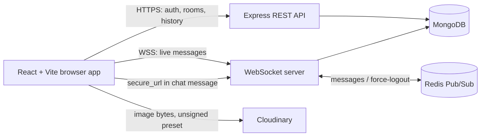

# LetsChat

LetsChat is a room-based chat application. The frontend is a React app built with Vite. The backend is an Express API and WebSocket server backed by MongoDB, with Redis Pub/Sub for cross-instance room broadcasts and Cloudinary for browser image uploads.

## Architecture



### Main request flows

- **Sign in and room data:** The browser calls the REST API for signup/login, room lists, room management, and message history. Protected REST routes accept a bearer access token; the JWT middleware also accepts the `accessToken` cookie.
- **Live chat:** The browser opens a WebSocket authenticated with its access token. The server checks room membership, saves each message in MongoDB, then publishes it to Redis. Each server instance sends the message to its connected members. If Redis is unavailable, the current server falls back to local broadcasts.
- **Images:** The browser uploads image bytes directly to Cloudinary with the configured unsigned preset. It then sends the returned `secure_url` as the message's `media` value. The backend stores and broadcasts that URL; it does not proxy the file. See [Cloudinary setup](./CLOUDINARY_SETUP.md).
- **Persistence:** MongoDB stores users, rooms, membership/admin state, join requests, and messages. Redis is used for transient cross-server events, not message history.

## Repository layout

```text
.
├── backend/
│   ├── config/redis.js         # Redis publisher and subscriber clients
│   ├── controllers/            # Auth, room, and message handlers
│   ├── middlewares/jwtAuth.js  # REST bearer/cookie JWT validation
│   ├── models/                 # Mongoose user, room, and message schemas
│   ├── routes/                 # /api/auth and /api/rooms routes
│   ├── ws/wsServer.js          # Authenticated WebSocket chat and Redis fan-out
│   ├── letschatapp.js          # Express, MongoDB, HTTP and WebSocket startup
│   ├── keepalive.js            # Periodic app/database/Redis keepalive checks
│   └── apiendpoint.md          # REST and WebSocket API reference
└── frontend/
    ├── src/App.jsx             # App state, REST actions, and Cloudinary upload
    ├── src/components/         # Chat, room, and authentication UI
    ├── src/hooks/useWebSocket.js # WebSocket connection and reconnect logic
    └── src/utils/              # HTTP API helpers and formatting
```

## Run locally

Start the backend from `backend`:

```bash
npm install
npm start
```

Start the frontend from `frontend` in a second terminal:

```bash
npm install
npm run dev
```

The backend needs `MONGO_URI` and `JWT_SECRET`. Redis uses `REDIS_URL` when configured and otherwise attempts `redis://127.0.0.1:6379`; it can fall back to local-only broadcasts. Password reset email uses `EMAIL_USER` and `BREVO_API_KEY`. `PORT`, `FRONTEND_URI`, and `BASE_URL` configure the listener, allowed frontend origin, and optional keepalive self-ping.

## Frontend environment

Create `frontend/.env.local` for local development. `frontend/.env.example` shows the API and WebSocket variables; add the Cloudinary values described in [Cloudinary setup](./CLOUDINARY_SETUP.md).

| Variable | Purpose |
| --- | --- |
| `VITE_API_URL` | HTTP API base URL, including `/api`. |
| `VITE_WS_URL` | WebSocket server URL. |
| `VITE_CLOUDINARY_CLOUD` | Cloudinary cloud name used by the browser upload. |
| `VITE_CLOUDINARY_PRESET` | Unsigned Cloudinary upload preset name. |

Vite embeds `VITE_` variables in browser assets. Treat them as public and never put an API secret in one. For deployment, set these variables in the frontend host and rebuild/redeploy after changes.

## Deployment endpoints

- HTTP API: `https://letschat-1-8pfq.onrender.com/api`
- Health check: `https://letschat-1-8pfq.onrender.com/ping`
- WebSocket: `wss://letschat-1-8pfq.onrender.com`

Use `VITE_API_URL` and `VITE_WS_URL` to point the frontend to a different deployment.

## API documentation

See [backend/apiendpoint.md](../backend/apiendpoint.md) for the current REST routes, request bodies, authentication rules, WebSocket protocol, and health check. The frontend's Cloudinary upload details are in [CLOUDINARY_SETUP.md](./CLOUDINARY_SETUP.md).
